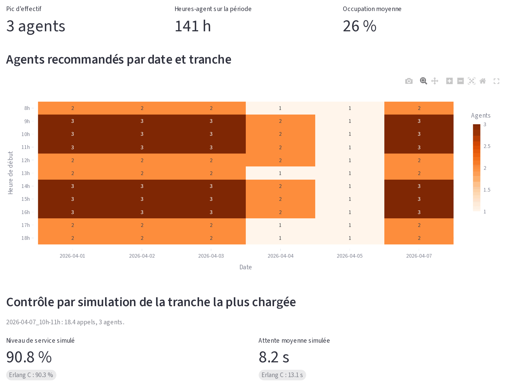
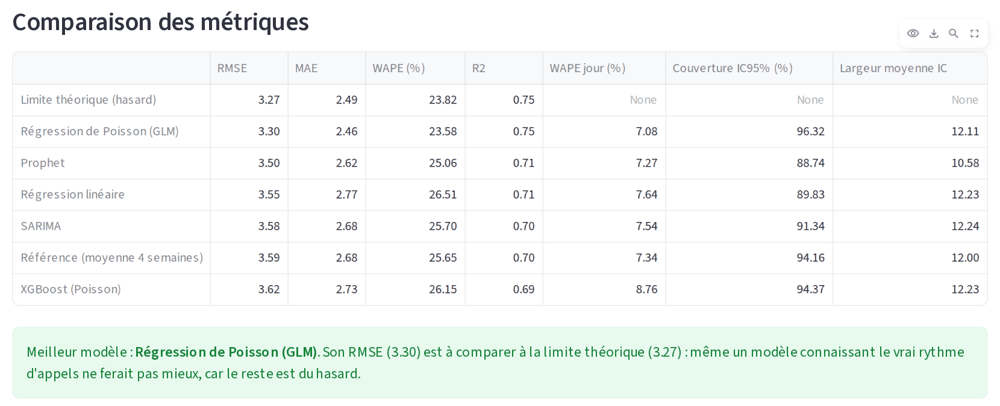

# Prévision d'appels et staffing

Application Streamlit qui prévoit le volume d'appels d'un centre de contact par
tranche horaire, puis calcule le nombre d'agents nécessaire pour tenir un objectif
de service, avec la loi d'Erlang C.

Prototype réalisé seul dans le cadre de mon projet de fin d'études (Mastère IA &
Management, IA School, 2026). Il complète [Taux_appel](https://github.com/Jerome-Servais/Taux_appel),
qui suit et explique les sollicitations par profil de client : ici, on anticipe la
charge pour dimensionner l'équipe.

Les données d'exemple sont **synthétiques** : les résultats ci-dessous décrivent le
comportement de la méthode, pas celui d'un centre d'appels réel.



## Résultats

Reproductibles avec `python evaluate.py --datasets 5 --runs 20 --all-models`.

### Le planning recommandé tient l'objectif

Le modèle apprend sur 12 semaines, recommande un planning, puis ce planning est
confronté à 4 nouvelles semaines simulées (20 répétitions), avec abandons et écarts
de vitesse entre agents. Objectif : 80 % des appels pris en moins de 20 s.

| Planning | Niveau de service | Pire tranche ouvrée | Abandons | Attente moyenne | Heures-agent / semaine |
|---|---:|---:|---:|---:|---:|
| D'origine | 71,1 % | 44,9 % | 15,5 % | 15,9 s | 126 |
| Recommandé | 92,0 % | 83,8 % | 3,4 % | 3,8 s | 185 |

Tenir l'objectif sur chaque tranche coûte 47 % d'heures-agent en plus. Le service
global dépasse l'objectif parce que l'effectif est un nombre entier et que le volume
par tranche est faible : un agent de plus a beaucoup d'effet.

### La prévision atteint presque la limite du hasard

Même en connaissant le vrai rythme d'appels, un modèle ne peut pas prévoir le hasard
d'un comptage. Cette limite sert de référence (5 jeux de données, 3 replis de 14 jours).

| Modèle | RMSE | WAPE | R² | Couverture IC 95 % |
|---|---:|---:|---:|---:|
| **Limite (vrai rythme connu)** | **3,26** | **23,4 %** | **0,76** | 97,1 % |
| Régression de Poisson (GLM) | 3,33 | 23,8 % | 0,75 | 96,8 % |
| Poisson bayésien (PyMC) | 3,33 | 23,8 % | 0,75 | 96,9 % |
| Prophet | 3,46 | 24,6 % | 0,74 | 89,7 % |
| Régression linéaire | 3,54 | 26,2 % | 0,72 | 90,3 % |
| SARIMA | 3,58 | 25,4 % | 0,72 | 92,2 % |
| XGBoost (Poisson) | 3,60 | 25,8 % | 0,71 | 95,4 % |
| Référence (moyenne 4 semaines) | 3,63 | 25,9 % | 0,71 | 94,6 % |

Par tranche horaire, le WAPE reste élevé car chaque tranche compte peu d'appels. Sur
le total de la journée, celui qui sert à planifier une équipe, il est de 8,3 % pour le
GLM, contre 7,6 % à la limite. Deux modèles restent sous la couverture visée de 95 % :
Prophet et la régression linéaire sont un peu trop confiants.

Le GLM est retenu par défaut : aussi précis que le modèle bayésien et bien plus
rapide. Le générateur favorise ce modèle, car l'effet du jour y multiplie exactement
celui de l'heure : sur des données réelles, il faudrait refaire cette comparaison.

## Lancement

Testé avec Python 3.12.

```bash
python -m venv venv
source venv/bin/activate      # Windows : venv\Scripts\activate
pip install -r requirements.txt
streamlit run app.py
```

L'application s'ouvre sur `exemple_donnees_appels.csv`. Pour lancer les tests et
reproduire l'évaluation (environ 3 minutes) :

```bash
pip install -r requirements-dev.txt
pytest
python evaluate.py --datasets 5 --runs 20 --all-models
```

## Pages

1. **Exploration** : niveau de service, abandons, DMT, attente, volume par tranche.
2. **Validation de Poisson** : test de dispersion global et détail par tranche.
3. **Prévision** : comparaison par validation glissante, face à la limite théorique.

   

4. **Staffing** : planning recommandé et contrôle par simulation de la tranche la plus chargée.
5. **Données synthétiques** : génération d'un nouveau jeu de données.

## Format du CSV

| Colonne | Description |
|---|---|
| `id_appel` | Identifiant unique |
| `date_heure` | Ex. `2026-01-15 09:23:11` |
| `statut` | `repondu` ou `non_repondu` |
| `post_appel` | Post-appel, en secondes |
| `temps_communication` | Conversation, en secondes |
| `temps_attente` | Attente avant prise d'appel ou abandon, en secondes |
| `id_agent` | Agent, vide si `non_repondu` |

## Méthode

- **Indicateurs** : le niveau de service mesure la part des appels pris dans le délai,
  le taux d'abandon celle des appelants qui raccrochent. La DMT additionne
  communication et post-appel, sans l'attente.
- **Tranches sans appel** : elles restent dans les données avec un volume de 0. Les
  retirer gonflerait les moyennes.
- **Prévision** : le modèle est réentraîné à chaque repli et ne voit jamais de données
  futures. Les intervalles portent sur le volume observé, pas seulement sur sa moyenne.
- **Poisson** : le test de dispersion regroupe toutes les tranches. Sur 13 semaines,
  une tranche isolée n'a pas assez d'observations pour conclure.
- **Staffing** : on retient le plus petit effectif qui respecte le niveau de service
  et l'occupation maximale, puis une simulation contrôle la tranche la plus chargée.
- **Données synthétiques** : les appels traversent une vraie file d'attente. L'attente
  dépend donc de la charge et du planning, sinon le staffing ne serait pas vérifiable.

## Architecture

```
app.py             interface Streamlit
utils.py           chargement, agrégation, indicateurs, tests de dispersion
models.py          modèles de prévision, métriques, validation glissante
staffing.py        Erlang C, recommandation, simulation de file d'attente
data_generator.py  données synthétiques
evaluate.py        évaluation reproductible
tests/             tests unitaires
```

Pour ajouter un modèle, créez une classe héritant de `BaseForecastModel` puis
ajoutez-la à `MODEL_REGISTRY` : l'application la propose automatiquement.

## Limites

- Erlang C ignore les abandons et ne tient pas compte des pauses ni des absences. Un
  planning réel doit ajouter ce temps non disponible.
- La prévision ne couvre que des effets récurrents. Une campagne ou un changement
  réglementaire demande une information externe.
- Trois mois d'historique ne permettent pas d'estimer une saisonnalité annuelle.
- Le comportement de patience des appelants est une hypothèse du simulateur.
